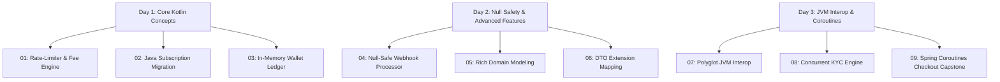

# Kotlin for Backend Engineering Master Course

Welcome to the hands-on repository for the **Kotlin for Backend Engineering Master Course**!

This project provides a comprehensive, production-grade guide to mastering modern server-side development with **Kotlin 2.x**, **Java 21 LTS**, and **Spring Boot 4.x/3.4+**, moving beyond boilerplate Java ceremony to build resilient, idiomatic, and high-throughput systems.

---

## Pedagogical Philosophy: Learn by Writing Idiomatic Kotlin

Reading syntax slides alone does not build backend intuition. In this repository, **every concept is taught through an interactive, test-driven hands-on experience**:
1. You start on a **starter branch** with real-world scenarios, legacy Java classes to migrate, or unimplemented domain contracts with deliberate code smells.
2. An accompanying `LESSON.md` breaks down the theory, code smells, architectural rules, and refactoring tasks.
3. Pre-written automated tests (**JUnit 5**, **AssertJ**, **Coroutines Test**) fail cleanly or highlight pending features, providing immediate feedback.
4. You implement idiomatic Kotlin solutions (smart casts, expression bodies, data classes, extension functions, structured concurrency).
5. You can compare your work directly with the corresponding **solution branch** using `git diff` or switching branches, reading the detailed `SOLUTION_EXPLANATION.md`.

---

## Course Structure & Branches

The curriculum is structured across **3 Core Days / Modules** covering **9 Hands-On Concepts** (each with a `-starter` and `-solution` branch):



---

## Complete Branch Catalog

| Day / Module | Concept | Starter Branch | Solution Branch |
| :--- | :--- | :--- | :--- |
| **Day 1: Core Kotlin** | 01. Backend Rate-Limiter & Fee Engine | `01-rate-limiter-fee-engine-starter` | `01-rate-limiter-fee-engine-solution` |
| | 02. Migrating Legacy Java Domain | `02-java-subscription-migration-starter` | `02-java-subscription-migration-solution` |
| | 03. In-Memory Wallet Ledger Engine | `03-wallet-ledger-engine-starter` | `03-wallet-ledger-engine-solution` |
| **Day 2: Null Safety & Idioms** | 04. Sanitizing Unreliable Webhook Payloads | `04-null-safe-webhook-processor-starter` | `04-null-safe-webhook-processor-solution` |
| | 05. Rich Domain Modeling with Data Classes | `05-rich-domain-modeling-starter` | `05-rich-domain-modeling-solution` |
| | 06. Null-Safe DTO-to-Domain Extension Mapping | `06-dto-extension-mapping-starter` | `06-dto-extension-mapping-solution` |
| **Day 3: JVM Interop & Coroutines**| 07. Two-Way Java ↔ Kotlin Interop | `07-jvm-polyglot-interop-starter` | `07-jvm-polyglot-interop-solution` |
| | 08. Structured Concurrency & KYC Timeouts | `08-concurrent-kyc-engine-starter` | `08-concurrent-kyc-engine-solution` |
| | 09. Resilient Microservice Checkout Aggregator | `09-coroutine-checkout-aggregator-starter` | `09-coroutine-checkout-aggregator-solution` |

---

## How to Work on an Exercise

### 1. Choose a Concept and Switch to its Starter Branch
```bash
git switch 01-rate-limiter-fee-engine-starter
```

### 2. Read the Lesson Guide
Open `LESSON.md` in your IDE or browser to understand the concept, scenario, tasks, and architectural guidelines.

### 3. Run the Tests to Inspect Current State
```bash
./gradlew test
```
Observe the test failures guiding you toward the expected behavior.

### 4. Implement Your Solution
Follow the tasks outlined in `LESSON.md` and guided `// TODO:` comments in `src/main/kotlin`.

### 5. Verify Your Solution
Re-run tests until all assertions pass:
```bash
./gradlew test
```

### 6. Compare with the Reference Solution
Inspect the clean diff between your branch and the solution branch:
```bash
git diff 01-rate-limiter-fee-engine-solution
# Or switch to the solution branch to view the complete solution & architecture notes
git switch 01-rate-limiter-fee-engine-solution
```

---

## Course Documentation & Resources
- 📖 **Course Slide Handbooks**:
  - [05. Core Kotlin Concepts](docs/05.%20Core%20Kotlin%20Concepts.md)
  - [06. Null Safety and Advanced Features](docs/06.%20Null%20Safety%20and%20Advanced%20Features.md)
  - [07. JVM Interoperability and Coroutines](docs/07.%20JVM%20Interoperability%20and%20Coroutines.md)
- 📐 **[Kotlin Backend Master Index](MASTER_INDEX.md)**: Null safety matrix, scope functions guide, `@Jvm*` interop rules, and structured concurrency guide.
- 🗂️ **[Detailed Branch Catalog](docs/BRANCHES.md)**: Complete catalog of all 18 branches with focus areas and key files.
- 🌐 **Interactive Documentation Site**: Run `npm run site:dev` to launch the Astro Starlight documentation portal and full-screen presentation slide deck runner.

---

## Prerequisites & Environment
- **Java 21 LTS** or newer.
- Gradle wrapper (`./gradlew`) included; no manual Gradle installation required.
- **Node.js 20+** (only needed for running the optional static documentation portal in `site/`).
